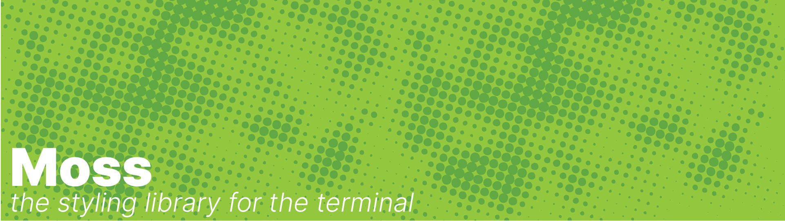

Moss renders ANSI-styled text and boxes for Gleam. A style is an immutable value.
Each setter returns a new style, so setters compose in a pipeline.

```gleam
import moss

pub fn warning_label() -> String {
  moss.new()
  |> moss.foreground(moss.Yellow)
  |> moss.bold
  |> moss.render("WARN")
}
```

`new()` starts with no colors or attributes. Use `foreground` and `background`
to set colors. Enable attributes with `bold`, `faint`, `italic`, `underline`,
`reverse`, `strikethrough`, or `blink`. Use `underline_style` and
`underline_color` for a terminal that supports extended underlines.

Use the matching `unset_*` functions to clear text effects and colors.
`moss.inherit(style, fallback)` fills unset properties from a base style and
keeps the receiving style's padding and margins. Use `moss/ranges` to apply
styles to grapheme ranges within ANSI-styled text.

`Color` includes the eight basic ANSI colors from `Black` through `White` and
their bright variants from `BrightBlack` through `BrightWhite`. All 16 follow
the terminal's palette. Use `moss.Indexed(201)` for an ANSI-256 palette entry
or `moss.Color(red: 136, green: 192, blue: 112)` for true color. Indices and RGB
channels are clamped to 0–255 when rendered. `moss.hex` parses six hex digits
with an optional leading `#` and returns `Result(Color, ColorError)`.
Malformed input returns `Error(moss.InvalidHex)`.

## Standalone blocks

Set padding or a border on a style to render a rectangular box. Padding
specifies top and bottom rows and left and right columns. Negative padding
becomes zero.

Run `gleam run -m example` to preview the padding and rounded border in a terminal.

```gleam
import moss

pub fn panel() -> String {
  moss.new()
  |> moss.padding(top: 1, right: 2, bottom: 1, left: 2)
  |> moss.foreground(moss.Cyan)
  |> moss.border_foreground(moss.Blue)
  |> moss.render("Hello!\n界")
}
```

Shorter lines are filled on the right based on their terminal cell width.
A trailing newline contributes an empty row. Tabs expand to eight-column
stops relative to the content. The interior style applies to the content
and its padding, one row at a time. Use `border_foreground` to add a colored
border, or pass a style to `rounded_border` for more control. Pass
`moss.new()` for a plain border. Box glyphs occupy one column in the default
width convention.

Set `width` to wrap and align content within a box and `height` to reserve
rows. Both include padding and borders. Use `margin` for space outside the
box, and `max_width` or `max_height` to clip the finished output.
`padding_fill`, `margin_fill`, and `fill` repeat patterns at terminal cell
boundaries.

Pass a preset or custom `Border` to `moss.border`. Use `border_sides` to
choose edges, `border_side_foreground` or `border_side_background` to color
an individual edge, and `border_gradient` to paint a color ramp clockwise
around the border.

## Compositing and output

Use `moss/compositor` to position rendered strings in a canvas. Coordinates
are zero-based terminal columns and rows. Layers with higher z-indices draw
on top. The canvas can clip content, render overlapping styles, and return
the layer ID at a painted cell.

```gleam
import moss/compositor

pub fn overlay(page: String, panel: String) -> String {
  compositor.render([
    compositor.layer("page", page),
    compositor.layer("panel", panel)
    |> compositor.position(x: 4, y: 2),
  ])
}
```

`moss/gradient` generates one- and two-dimensional CIELAB color ramps.
`moss/terminal.println` adapts ANSI colors to the detected terminal profile
and prints plain text when redirected. Use `moss/terminal.background_is_dark`
during startup to choose a palette before another reader takes stdin.

`moss/table`, `moss/list`, and `moss/tree` render styled tables, nested
lists, and trees with multiline labels.

## Moss layout demo

Run `gleam run -m moss_layout` in a terminal at least 100 columns wide to
see the full [Moss layout demo](src/moss_layout.gleam), including
the gradient dialog, color grid, and floating overlay.

The demo builds its tabs and lists with custom border sides, colors the
dialog with a grapheme gradient, and layers the floating panel over the page.
It detects the terminal background at startup and uses the dark palette as a
fallback. `moss_layout.render(False, 0)` returns the full light-palette render.

## Rendering at redraw time

Use `moss.span_style` to clear box settings before storing a style in a
cell. At redraw time, compare frames and group adjacent changed cells on the
same row whose styles compare equal with `==`. Concatenate each run's text and
call `moss.render` once per run.
Start drawing in a known default terminal style so plain runs inherit those
defaults.

`render` returns plain text unchanged for an empty style. For a styled run it
adds one opening ANSI SGR sequence and a trailing `ESC[0m` reset. Pass plain
text spans. Embedded ANSI is passed through, so an embedded reset clears the
active terminal style for the rest of the span. In a cell-based redraw, the
caller owns terminal I/O, cursor movement, screen state, input, and layout.

## Development

```sh
gleam format --check src test
gleam check
gleam test
```
